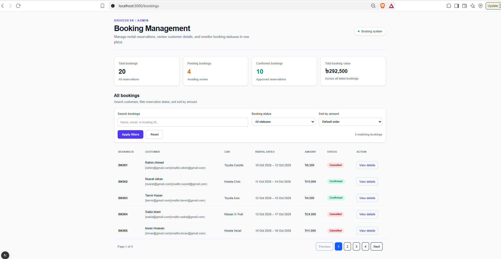
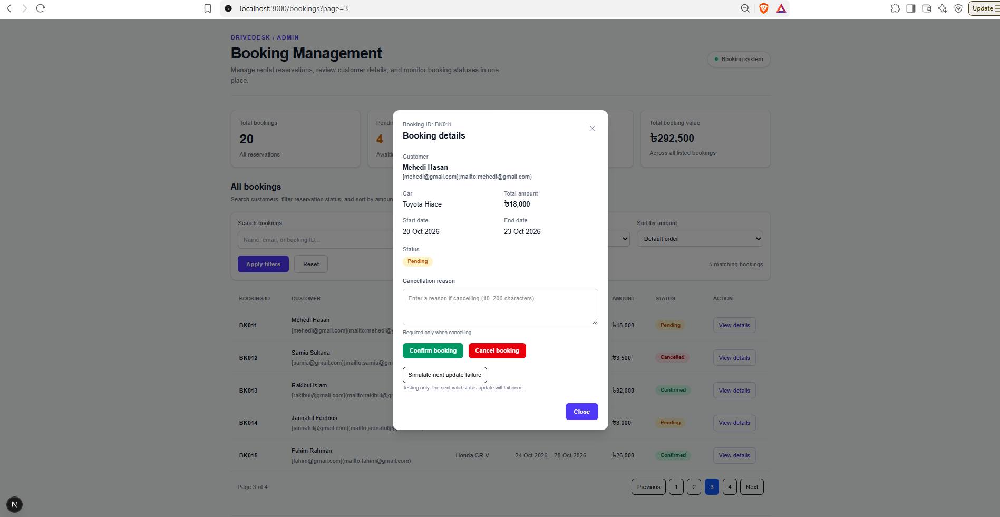
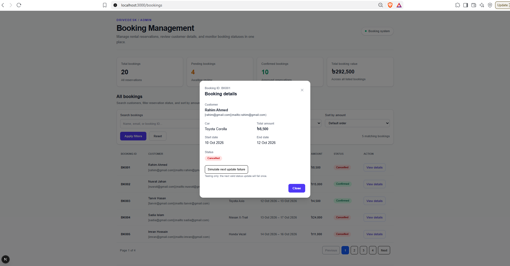
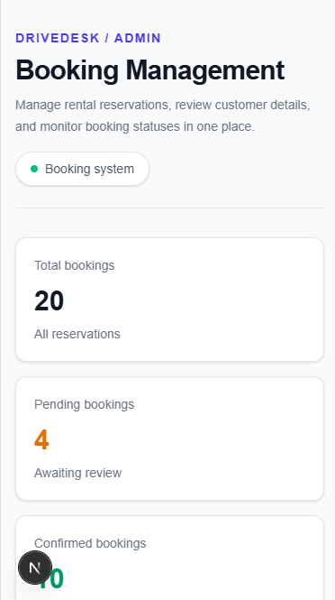
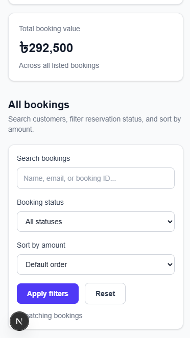
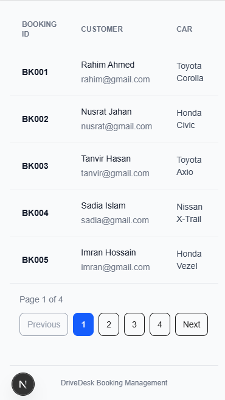
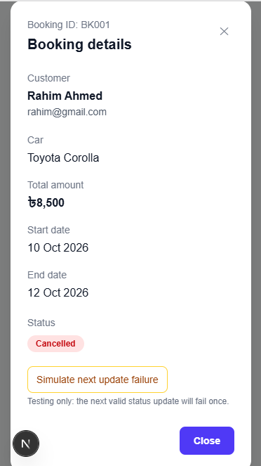

# Car Rental Booking Dashboard

A responsive booking management dashboard built with Next.js, TypeScript, and Tailwind CSS.

## Features

- View and manage car rental bookings
- Search by customer name, email, or booking ID
- Filter bookings by status
- Sort bookings by total amount
- Server-side pagination with five bookings per page
- URL-synced search, filters, sorting, and pagination
- Booking details modal
- Server Actions for booking status updates
- Cancellation reason validation
- Loading and error states
- Development-only failure simulation

## Tech Stack

- Next.js App Router
- TypeScript
- Tailwind CSS
- Local JSON file for booking data

## Requirements

- Node.js
- npm

## Installation

```bash
npm install
```

## Run in Development

```bash
npm run dev
```

Open [http://localhost:3000/bookings](http://localhost:3000/bookings).

## Production Build

```bash
npm run build
```

## Data Storage

Sample bookings are stored in `data/bookings.json`. Status updates are saved to this file.

## Testing

Manually test search, status filtering, sorting, pagination, browser history, booking details, status transitions, cancellation validation, failure simulation, and responsive layouts.

## Screenshots

Desktop and mobile screenshots of the booking dashboard are included below.

### Dashboard



### Booking details on page 3



### Cancelled booking details



### Mobile views









## Tools Used

- **Next.js, TypeScript, and Tailwind CSS:** Application framework, typing, and styling.
- **Git:** Version control.
- **VS Code:** Development environment.
- **AI assistance:** ChatGPT was used for implementation guidance, code suggestions, debugging, explanations of Next.js concepts, and help designing tests and documentation. I reviewed and tested the resulting code and am responsible for understanding the submitted implementation.

AI_FULL_IMPLEMENTATION

The AI assistance contributed code for parts of the booking dashboard, query handling, pagination, modal interactions, status-update workflows, loading/error states, and submission documentation. The developer reviewed and adapted the implementation and is responsible for understanding the submitted code.
